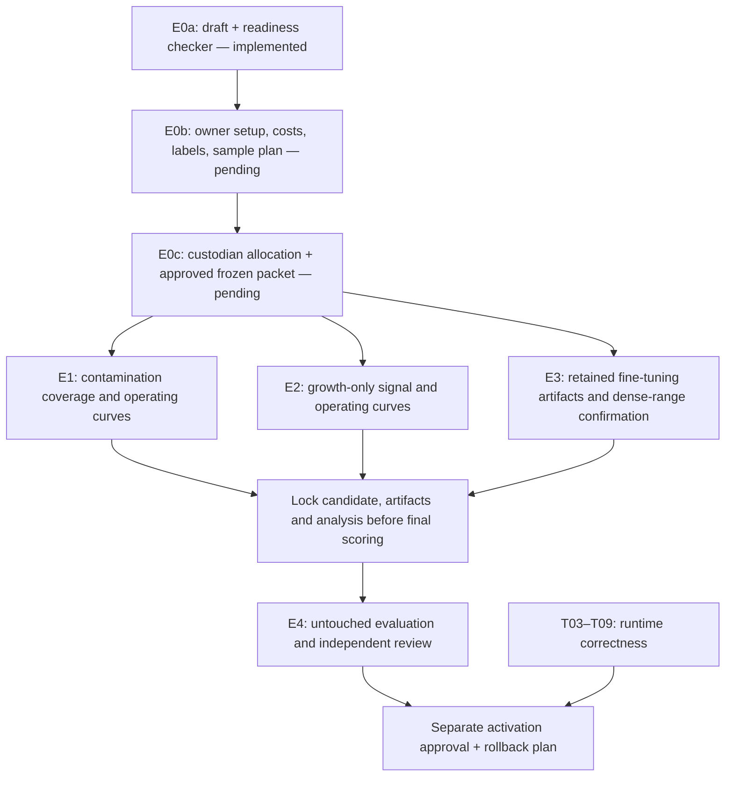

# Detection and confluency confirmation: E0–E4

Status, 2026-10-18: **E0 preparation tooling and offline E1/E2 signal APIs implemented; protocol approval and real data allocation pending. No protocol is frozen and no new biological efficacy evaluation has run.**

This implements the next step from the [capabilities and thresholds review](../../reviews/2026-10-17-capabilities-and-thresholds.md). The purpose is better measurements and useful alerts, not making historical failures disappear by changing acceptance criteria. It is separate from the completed website work and pending human screen-reader/zoom checks.

The [online-researched pilot proposal](../../reviews/2026-10-17-researched-pilot-thresholds.md) supplies acquisition examples and proposed alert/delay budgets, with primary sources and workload calculations. These are not universal standards or owner-approved settings; the draft protocol remains unresolved.

The [T10 partner pilot protocol](../partner-pilot.md) now supplies the broader
confluency/audit-first evaluation and [approval worksheet](../partner-pilot-approvals.md).
E1/E2 remain optional, separately approved detector studies; E3 is the separate
fine-tuning/measurement confirmation arm. Writing T10 does not complete E0 or
authorize new data collection, scoring or activation.

The [signal implementation handoff](../../reviews/2026-10-18-detection-signal-implementation.md)
documents full-frame native tiling, frozen-prefix growth deficits, regression
tests and bounded offline smoke checks. These are preparatory tools, not an E0
bypass or completion of E1/E2 operating-curve validation. T06's segmentation
identity fix is implemented locally with [real-model CPU parity verified](../../reviews/2026-10-18-cellpose-release-validation.md);
target-host provisioning/capacity validation remains pending.

## Implementation flow



Run a separate packet for each workstream. The join applies to the capabilities selected for that evaluation, not a requirement to deploy all three. E0 fixes the evaluation design; a later candidate lock fixes the exact learned weights, operating cutoff and analysis implementation before E4. The E0 checker does **not** implement that later lock or authorize scoring/activation.

## E0: owner and custodian handoff

Copy `protocol.draft.json` and `manifest.draft.json` into a new versioned experiment directory; leave these templates unresolved. Do not populate them with invented approvals or the already-inspected historical test sets.

The owner must supply:

| Fields | Required decision |
|---|---|
| `setup_id`, `microscope`, `objective`, `cell_type`, `pixel_size_um` | Exact intended instrument/acquisition setup, not a borrowed C2C12 scale |
| `fov_strategy`, `cadence_hours` | Physical area, number/placement of FOVs, registration approach and visit interval |
| `label_method` | How an independent reference confirms contamination, healthy growth/stall, or expert confluency; define control/case for this workstream |
| `primary_endpoint`, `acceptance_rule` | Outcome, numerator/denominator, required confidence bound and numeric acceptance criteria fixed before results |
| `max_false_alerts_per_100`, `false_alert_denominator`, `max_detection_delay_hours` | Explicit alert-cost/delay budget; images, visits and decisions are not interchangeable |
| `minimum_independent_groups`, `sample_size_justification` | Culture counts per control/case and split, justified by expected uncertainty; frame counts cannot substitute |
| `candidate_plan` | Bounded candidate configurations, comparison baseline and tuning-only selection/tie-break rules |
| `gate_rejection_policy`, `analysis_plan` | Handling of missing/rejected visits, no-alert runs, uncertainty, repeated observations and subgroup reporting |
| `artifact_retention_plan` | Exact weights, configuration, source revision/patch, environment, seeds, outputs and hashes to retain |
| `owner`, `approval_reference`, `final_test_custodian`, `split_assignment_reference` | Accountable approval and separately controlled held-out allocation |

For E3, define false alerts as erroneous action recommendations if that is the approved endpoint; use `decisions` and delay `0` for immediate image-based decisions, explaining this in the analysis plan. Do not silently reuse E1 contamination budgets. The checker requires complete fields, but a scientific reviewer must judge whether the endpoint, labels, uncertainty method and sample-size justification are adequate.

The allocation custodian builds `samples`, one row per unique image:

```json
{
  "sample_id": "unique-acquisition-id",
  "split": "final_test",
  "culture_id": "globally-unique-biological-culture-id",
  "sequence_id": "globally-unique-sequence-id",
  "session_id": "globally-unique-acquisition-session-id",
  "lineage_id": "root-source-culture-or-simulation-family-id",
  "image_sha256": "<64 lowercase hex characters from the original image bytes>",
  "label": "case",
  "label_origin": "confirmed",
  "label_reference": "independent-reference-record-id",
  "prior_use": "unseen"
}
```

- Splits are `development`, `tuning`, `final_test`. Labels are `control` or `case`; their biological meaning must be defined in `label_method`.
- `label_origin` is `confirmed` or `simulated`. Simulation cannot be promoted into evidence of natural contamination detection. Reports must separate these strata.
- `prior_use` is `unseen`, `development` or `historical_evaluation`. Final-test data must be unseen by candidate selection/tuning; custodian label preparation is allowed. Existing reviewed evidence is not a new untouched final test.
- Use consistent global IDs. Parent cultures, derived crops, augmented images, simulated variants and retimed visits retain shared lineage. Any shared culture, sequence, session or lineage across splits is blocked. Duplicate image hashes are blocked even within a split.
- The same culture may supply multiple frames and control/case phases within one split; it counts once per label, not as independent control and case cultures combined. Report paired dependence and cluster uncertainty at the highest relevant unit, including shared sessions/lineages.
- The checker counts distinct culture IDs, not statistical independence. ID integrity, biological independence, labels and sufficient sample size require custodian/reviewer confirmation. Renaming IDs cannot legitimately remove leakage.

## Readiness command

```sh
.venv/bin/python scripts/check_experiment_protocol.py \
  docs/specs/detection-experiments/protocol.draft.json \
  docs/specs/detection-experiments/manifest.draft.json
```

The supplied drafts intentionally return exit **1** with `ready: false`. Exit **0** means only structural checks passed. The command reads two JSON files, does not load images/models, does not write files and does not change product thresholds.

For a real packet:

1. Allocate and finalize manifest bytes. Obtain their SHA-256 with `shasum -a 256 <manifest-path>` and set `manifest_sha256` in the protocol.
2. Resolve all fields and obtain owner approval; set `status` to `approved`. Run the checker on those two files and retain its output.
3. Have the owner/custodian independently retain the reported **protocol and manifest digests**, with an approval record referring to those exact hashes. An approval reference is not a cryptographic signature; self-entered status is not authenticated by this tool.
4. Keep final-test images and score access under separate custody. Changing either frozen file requires a new version and renewed approval, before scoring. The checker detects a changed manifest against its protocol, but cannot detect a coordinated rewrite of both without the independently retained digests.

This is a preflight aid, **not an enforced sandbox or an experiment runner**. Existing scoring scripts do not call it. It cannot prove files match declared image hashes without reading them, enforce data access, authenticate approval, verify true prior use or stop somebody rerunning a test. E4 needs a controlled run record and candidate-artifact lock, not just this command.

## Next implementation packets

| Packet | Implement once inputs are ready | Required checks and output |
|---|---|---|
| E1 | A cached-score operating-curve evaluator; then bounded centre-tile versus multi-tile/native-resolution inference | Tune cutoffs only on tuning controls; report recall, false alerts, per-sequence/cluster intervals and missed images. No cutoff-success claim when ranking lacks separation. Confirm target-scale labels first. |
| E2 | A growth-only replay evaluator comparing rolling versus frozen healthy references, FOV strategies and accumulation horizons | Include healthy runs, slowdowns, sampling noise and gate-rejected visits separately. Report detected independent sequences, delay and false alerts/100 visits; never reuse the historical combined-monitor sweep as growth-only evidence. |
| E3 | Retained model/run manifests and dense-range measurement/action confirmation | Preserve exact weights; assess error, bias, interval coverage, early passage and review burden around the target. Existing illustration weights are not the lost scored models. |
| Candidate lock | Exact selected artifacts and analysis command, source/environment identity, predeclared exclusions and run authorization | Hash every selected artifact and retain independent approval before releasing final-test scores. No test-feedback tuning. |
| E4 | A single controlled final-test evaluation for the selected capabilities | Preserve all outcomes; report insufficient evidence or regressions honestly. A changed model/cutoff after test inspection needs a new untouched test. Runtime fixes and separate activation approval remain required. |

Bound compute separately: inventory exact input hashes, candidate count, resolution/FOV variants, expected CPU/GPU use, output paths and stop conditions before inference. Current authorization does not imply remote jobs, downloads, publishing or deployment.

## Current handoff

- Implemented: draft templates, read-only structural readiness checker, experimental coverage/growth probes and regression tests.
- Pending: owner setup/alert costs, independent labels/data, defensible sample plan, custodian allocation and approval. **E0 is not complete.**
- Unchanged: historical scientific results, detector activation/thresholds, website content and precomputed demo behavior. T06 changes shipped-model loading and record identity; see the handoff.
- Human screen-reader and actual 200% zoom verification remain pending. No push or deployment.

### Verification

- `.venv/bin/python -m pytest -q tests/test_experiment_protocol.py`: **48 passed**.
- `git diff --check`: passed.
- Running the supplied draft packet returns structured blockers and exit 1, as intended, without modifying either input.
- Regression coverage includes every leakage identity, duplicate images, per-culture rather than per-frame counts, historical final-test reuse, incomplete approvals, malformed rows, nonfinite/oversized numeric values and exact manifest-byte binding.
- Independent review found duplicate-image counting and oversized-integer handling gaps; both now have fixes and regression tests. These tests use artificial fixtures only, not new scientific evidence.
