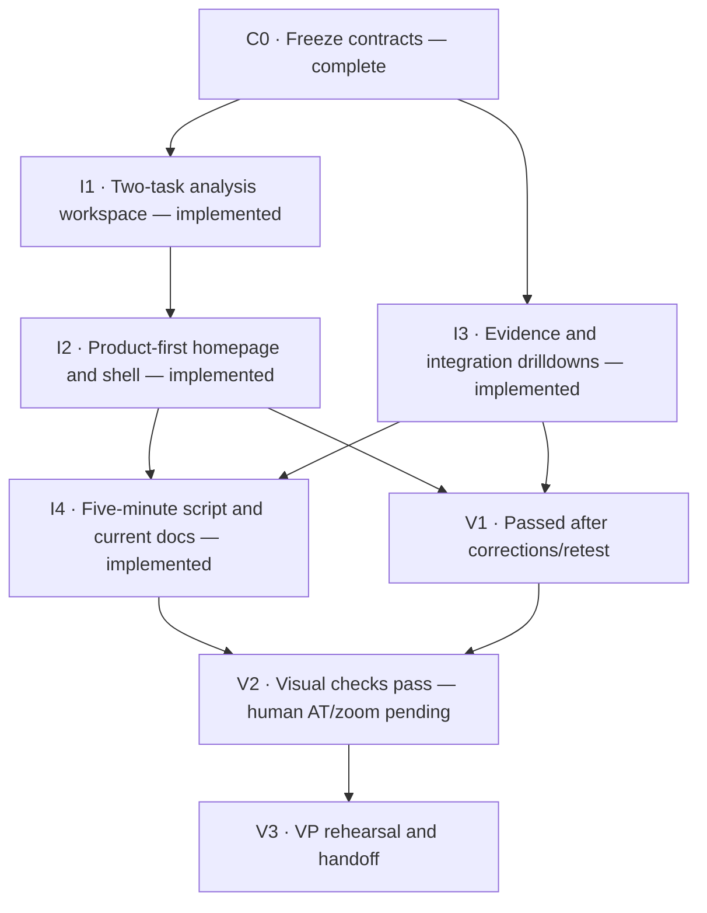

# Standalone cultureQC site: implementation DAG

Status: **I1–I4 implemented; V1 passed; V2 scoped visual/regression checks pass, human AT/200% zoom evidence pending; V3 pending**. Updated: 2026-10-17. See the [I1 handoff](../../reviews/2026-10-16-i1-workspace-handoff.md), [I2 handoff](../../reviews/2026-10-16-i2-homepage-handoff.md), [I3 handoff](../../reviews/2026-10-16-i3-proof-handoff.md), [I4 handoff](../../reviews/2026-10-16-i4-demo-handoff.md), [V1 correction/retest record](../../reviews/2026-10-16-v1-acceptance.md) and [V2 visual evidence and manual handoff](../../reviews/2026-10-17-v2-visual-followup.md).

The owner approved the [product-first direction](../../reviews/2026-10-16-v4-standalone-product-design.md). These packets turn it into executable work. They supersede that proposal's coarse S1–S4 handoff and the old comparison-first narrative, not the [correctness backlog](../../reviews/2026-10-15-v4-vs-v2-agent-backlog.md).

The [secondary technical-selector follow-up](../../reviews/2026-10-17-technical-controls.md) is also implemented and checked, including a replay-switch crash found during keyboard testing. It does not close the remaining human acceptance gates.

The [code-first follow-up](../../reviews/2026-10-17-demo-code-followup.md) closes the remaining recorded demo test-harness cleanup work. All three saved browser regressions, 11 Node tests and the production build pass. Human acceptance and the separate backend correctness track remain open.

Subsequent [T12 local work](../../reviews/2026-10-20-proof-journey-and-current-guidance.md)
adds the separate illustrative review, corrects legacy record navigation and
updates current guidance. Runtime T03–T11 implementations are recorded in the
[technical backlog](../../reviews/2026-10-15-v4-vs-v2-agent-backlog.md); implementation
does not close scientific, partner or release gates. T12 authorizes its separate
generated demonstration, not rewriting historical records. The subsequent
[post-update visual acceptance](../../reviews/2026-10-20-proof-visual-acceptance.md)
adds fresh desktop/mobile review-section captures and passes the chain-link
scrolling retest without the workaround. Human AT/200% zoom and V3 remain pending.

## Outcome

A VP can understand the product, inspect an image/result, explain why a person reviews a boundary case, and identify the next evaluation—without learning about v2. The improvement is experienced through the product, not asserted through version statistics. No new backend, evidence, production-readiness or commercial-clearance claim follows from this work.

## DAG

Arrows are finish-to-start dependencies. All incoming dependencies must pass before a node starts. C0 is complete as documentation; I1–I3 implementation and scoped functional checks are complete; I4 documentation and static checks are complete. V1's three findings are corrected and independently closed, with fresh regression checks passing. V2's six source corrections pass independent review and scoped browser confirmation. The approved browser update restored captures, and inspected desktop/mobile/layer evidence passes scoped visual review; actual assistive-technology speech and 200% zoom evidence remain pending. V3 awaits V2. Final browser/visual acceptance and timed rehearsal are separate from implementation completion. No elapsed-time or readiness promise is implied.

| ID | Dependencies | Owner | Packet / completion artifact |
|---|---|---|---|
| C0 | None | Orchestrator | [00-contracts](00-contracts.md); frozen routes, content and scope |
| I1 | C0 | Frontend builder | [01-workspace](01-workspace.md); workspace + focused tests |
| I2 | I1 | Same frontend builder | [02-homepage](02-homepage.md); composition, shell, metadata |
| I3 | C0 | Evidence/integration builder | [03-proof](03-proof.md); drilldown content + source audit |
| I4 | I2, I3 | Documentation owner | [04-demo](04-demo.md); executable script and current product docs |
| V1 | I2, I3 | Independent reviewer | [05-acceptance](05-acceptance.md); [passed after three corrections and retest](../../reviews/2026-10-16-v1-acceptance.md) |
| V2 | I4, V1 | Browser reviewer | [visual checks pass; human AT/zoom pending](../../reviews/2026-10-17-v2-visual-followup.md); [initial browser matrix](../../reviews/2026-10-17-v2-browser-acceptance.md) |
| V3 | V2 | Presenter + reviewer | [05-acceptance](05-acceptance.md); timed walkthrough and final report |

## Dispatch and file ownership

1. Dispatch I1 and I3 in parallel. Keep one frontend owner for I1 → I2; their layout and state changes are coupled.
2. I3 must not edit `Journey.jsx`, `Journey.css`, `Shell.jsx` or `styles.css`. It sends evidence/integration copy requirements to I2, whose spec already defines the homepage contract. I3 may add a page-scoped stylesheet if needed.
3. After both build lanes finish, I4 and V1 can run in parallel. V1 is read-only except for its report; return defects to the owning builder instead of racing edits.
4. Run V2 once both predecessors pass, then V3. Do not spend extra agents on adjacent JSX files that share styling. Use at most two builders plus the orchestrator; reuse an idle slot for independent review.
5. Each handoff records ID, dependency state, changed files, checks/results, known gaps and any contract deviation. A blocked node names the failed condition; unrelated ready nodes may continue.

V2 correction assignment: the Records builder exclusively owns its reduced-motion edit and the shared stylesheet's tamper-switch background only. The orchestrator owns workspace semantics/borders and the mobile navigation mask. This narrow shared-style exception does not authorize broader I3 edits to I2 files.

Gate failures keep the node pending. Record a fix/retest against that same node; do not invent a backwards dependency or mark a partial gate passed. Dependent gates must be rechecked when fixes invalidate their evidence. One batched desktop/mobile visual inspection, one batch of corrections, and at most one confirmation pass; unresolved visual defects remain explicit blockers.

## Scope and release boundary

- Work on the current non-main branch; preserve existing uncommitted work. No new branch, commit, merge, push or deployment is authorized by this plan.
- `site/src/data.json`, canonical records, source results, model/configuration code, generated deployment copies and unrelated user docs are not editing targets. Inspect them as evidence; do not regenerate them for copy/layout changes.
- T03–T09 are a separate runtime-correctness track. They do not block presenting honestly labelled stored examples, but remain unresolved prerequisites to relying on the affected live capabilities. UI completion cannot close them.
- T02's matched version study is internal validation, not a dependency of this DAG. T10's partner-specific protocol and T11's readiness/clearance decisions are not delivered by a polished evaluation CTA.
- Completion means accepted local website/demo experience, not validated automation or public release.

## Ready-to-send agent instruction

“Implement node `<ID>` from this DAG only after its dependencies pass. Read `00-contracts.md`, your packet, applicable repository instructions and the approved design. Edit only owned files; coordinate shared-file requests with the orchestrator. Preserve all pre-existing edits and immutable evidence. Return changed paths, acceptance IDs checked, exact commands/results and unresolved limits. Do not commit, deploy, change scientific outputs or claim downstream gates passed.”
